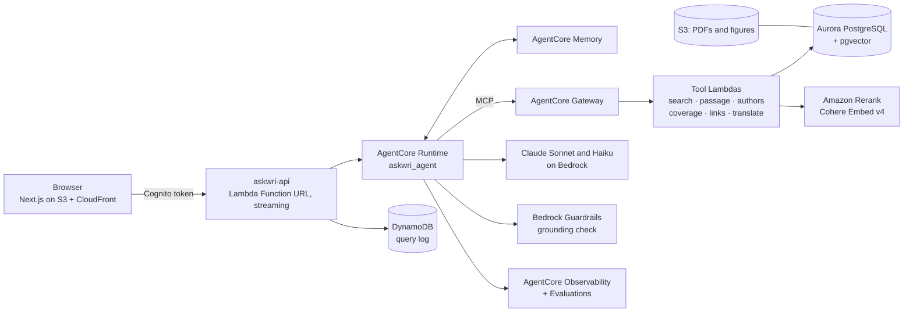

# AskWRI

A research assistant that answers questions from the World Resources Institute's own
publications. Every claim is checked against the page it came from and cited to it, and when
WRI's research doesn't answer a question, AskWRI says so instead of guessing. Built by team
DefinitelyNotAI for an AWS hackathon, on Amazon Bedrock and Bedrock AgentCore.

- **Live:** https://d17gz0gh5g00t3.cloudfront.net (invite only)
- **Using it, no technical knowledge needed:** [USER-GUIDE.md](USER-GUIDE.md)
- **What we built and why:** [docs/PROJECT-OVERVIEW.md](docs/PROJECT-OVERVIEW.md)
- **Deploy it from an empty AWS account:** [docs/REPRODUCE.md](docs/REPRODUCE.md)
- **Taking it over:** [docs/HANDOFF.md](docs/HANDOFF.md)

## The problem

WRI has published hundreds of research reports. The findings people need are in there, but
finding the right one, on the right page, takes hours. A general chatbot is fast, but it can
invent a number or a conclusion, and for WRI one invented figure is a credibility problem.

## What AskWRI does

| Feature | What it means for the reader |
|---|---|
| **Cited answers** | Every sentence is cited to a WRI publication and page. One click opens the PDF at that page with the passage highlighted. |
| **Checked before it's shown** | Each claim is checked against its passage, then by Bedrock Guardrails' grounding check. Unsupported sentences are removed. |
| **Honest "no answer"** | When the evidence isn't there, it declines and shows what it searched and the closest WRI work. |
| **Written for the reader** | It works out who is asking (researcher, policymaker, partnerships) and writes in the right form. |
| **Deep research and briefings** | Splits a topic into sub-questions searched in parallel and writes a structured report: summary, issue brief, evidence matrix and more. |
| **Fact-check a draft** | Paste a draft; each claim comes back supported, contradicted or not found in WRI's research, with the source. |
| **Search inside charts and maps** | Every informative chart, map and table was described when loaded, so you can find what a figure shows. |
| **How the research connects** | A citation map of which WRI report builds on, uses or updates which, with the citing sentence. Key figures quoted word for word. |
| **Spaces and filters** | WRI's 11 topics as spaces in the sidebar; filters for region, year and publication type. |
| **Research lens** | State your goal and the topics to compare; every paper gets a focused summary for each. |
| **Languages** | Ask and get answers in Spanish, Portuguese or Bahasa Indonesia; sources stay in the original so citations stay exact. |
| **Follow-ups** | "Make it shorter", "now in Spanish", "turn it into talking points": the chat remembers. |
| **Admin page** | Quality scorecard from the evaluation run, model-graded scores, live cost, latency and declines, and a review view for any question. |
| **Sign-in** | Invite-only Amazon Cognito accounts; an admin group for the admin page. |

## How it works



1. **Ingestion** (one resumable command): sort the PDFs, read them with a layout-aware parser,
   cut passages with PDF and printed page numbers, describe charts and maps with a vision model,
   audit every passage against the PDF text, label each document from wri.org (else a small
   model), embed with Cohere Embed v4, and load each document into Aurora in one transaction.
2. **Search** (a tool behind AgentCore Gateway): vector and keyword search fused by reciprocal
   rank fusion, filters, at most 6 passages per document, supporting material (references,
   contents) skipped, best 30 reranked by Amazon Rerank.
3. **Agent** (AgentCore Runtime): plans the searches, retries or widens when evidence is weak,
   drafts with Claude Sonnet 5.5 citing passages, verifies every claim twice, declines when
   nothing survives, translates when asked. Steps stream to the browser.
4. **Evaluation**: a 30-question test set scored on every release, plus AgentCore Evaluations'
   built-in judges (LLM-as-a-judge) on the same traces and on live traffic.

## Results

Evaluation run `20261105-050756`, 30 questions, on the full library:

| Measure | Result | Target |
|---|---|---|
| Answers with every figure cited | 100% | 100% |
| Expected report among the first 5 cited (recall@5) | 92% | ≥ 75% |
| Out-of-scope questions declined | 3 of 3 | all |
| Claims kept after verification | 90% | — |
| Reader inferred correctly | 96% | — |
| AgentCore judges: relevance · correctness · faithfulness | 0.97 · 0.88 · 0.82 | — |
| Median time to a cited answer, Quick · Deep | ~20 s · ~25 s | < 60 s |
| Cost per answer | about $0.05 | — |

Library: 580 WRI publications (2014–2026) from 727 PDFs; 28,104 passages, 3,463 tables, 2,289
charts, maps and images described; 2,824 citation links between reports. How these were
measured, and their limits, are in [docs/PROJECT-OVERVIEW.md](docs/PROJECT-OVERVIEW.md#results-and-how-we-measured-them).

## Run it

**Use the hosted app:** ask an admin for an account, then open the live link above.

**Run the UI locally against the deployed API** (Node 22+):

```sh
cd web && npm install
# web/.env.local: NEXT_PUBLIC_ASKWRI_API_URL and NEXT_PUBLIC_ASKWRI_API_KEY (see docs/developer-reference.md)
npm run dev            # http://localhost:3000 (without the URL it uses a built-in mock)
```

**Ask the agent from a terminal** (Python 3.12 with `uv`, AWS credentials for the account):

```sh
uv sync
uv run python -m askwri.agent.ask "How do cities protect people from extreme heat?"   # --deep, --language es
```

**Tests:**

```sh
uv run pytest                        # Python: ingestion, search, citations, agent, API
cd web && npm test && npm run lint   # UI logic and type check
```

**Deploy everything:** [docs/REPRODUCE.md](docs/REPRODUCE.md), step by step.

## Repository layout

```
askwri/ingest/     ingestion pipeline: sort, parse, chunk, audit, labels, figures, embed, load
askwri/tools/      tool Lambdas behind AgentCore Gateway (search, passage, authors, coverage, links, translate)
askwri/agent/      the agent on AgentCore Runtime: loop, citations and verification, fact-check, lens, visuals, memory
askwri/api/        the HTTP API Lambda: streaming chat, sign-in checks, PDF links, admin endpoints
askwri/answer/     the first stand-alone Quick answer (kept for reference; the agent replaced it)
askwri/links.py    citation links between documents     askwri/spaces.py  topic counts for the sidebar
db/                schema.sql and helpers (applied through the RDS Data API)
eval/              30-question test set and the end-to-end evaluation runner (+ AgentCore judges)
evals/             search-only evaluation (passage relevance graded by a model)
infra/             Terraform: network, storage, database, tools, gateway, agent, api, users, web, evaluation
web/               Next.js UI: chat, side panel, visuals, admin page
scripts/           deploy-web.sh, record_demo_chats.py, setup.sh
docs/              overview, reproduce, handoff, design, developer reference, demo scripts, task notes
tests/             Python tests
```

## Documentation

| Document | For |
|---|---|
| [USER-GUIDE.md](USER-GUIDE.md) | Anyone using AskWRI |
| [docs/PROJECT-OVERVIEW.md](docs/PROJECT-OVERVIEW.md) | What we built, the strategies and decisions, results, lessons |
| [docs/REPRODUCE.md](docs/REPRODUCE.md) | Deploying the whole system from an empty AWS account |
| [docs/HANDOFF.md](docs/HANDOFF.md) | Current state, known issues and next steps |
| [docs/developer-reference.md](docs/developer-reference.md) | Every module, command and setting in detail |
| [docs/askwri-solution-design.md](docs/askwri-solution-design.md) | The original solution design |
| [docs/ingestion-architecture.md](docs/ingestion-architecture.md), [docs/richer-metadata.md](docs/richer-metadata.md) | Ingestion and labels |
| [docs/evaluation-spec.md](docs/evaluation-spec.md) | How quality is evaluated |
| [docs/ui-handoff.md](docs/ui-handoff.md) | UI behaviour each feature must keep |
| [docs/data-and-qa.txt](docs/data-and-qa.txt), [docs/demo-final-script.txt](docs/demo-final-script.txt) | Data summary, Q&A prep, demo script |
| [docs/tasks/](docs/tasks/) | One file per task: goal, decisions, handoff notes |
| [AGENTS.md](AGENTS.md) | Rules for contributors and AI coding tools |

## Contributing

Work goes on a branch and into `main` through a pull request; secrets are blocked by a commit
hook. The team workflow (Claude Code or Codex skills `setup`, `claim-task`, `handoff`, `review`,
`create-pr`) and the code rules are in [AGENTS.md](AGENTS.md). Troubleshooting:
[docs/developer-reference.md](docs/developer-reference.md#faq).
