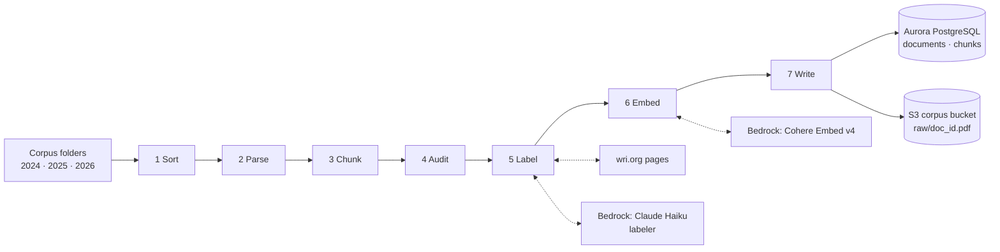

# Data ingestion architecture

How WRI PDFs become searchable, citable rows in Aurora. The code is in `askwri/ingest/`.
One command runs it:

```sh
scripts/run-pipeline.sh [--reload] 2024 2025 2026     # one corpus folder per publication year
```

## Overview



## Steps

| # | Step | What it does | Code | External calls |
|---|---|---|---|---|
| 1 | Sort | Drops exact duplicates, non-English files and older versions. Gives each document a type (working paper, RFP, newsletter...). | `sort.py`, `classify.py` | none |
| 2 | Parse | PyMuPDF's layout model reads text, headings and tables in reading order. Page headers and footers give the printed page numbers. | `pdf.py`, `pages.py`, `tables.py` | none |
| 3 | Chunk | Cuts 400 to 2,000-character chunks that never cross a heading. A table is its own chunk. Each chunk gets a stable ID, its section path and, under headings such as References, Notes or Contents, a `role`. | `chunks.py` | none |
| 4 | Audit | Checks every chunk against the PDF's text layer. Words not on their page block the document; re-ordered words make a chunk unquotable. | `audit.py` | none |
| 5 | Label | Finds the wri.org page and reads WRI's labels, else asks the labeler. Adds the folder year, acronyms, one enrichment call per document and a summary per table. | `labels.py`, `wri_site.py`, `model_labels.py`, `acronyms.py`, `table_summary.py` | wri.org, Claude Haiku |
| 6 | Embed | Embeds each chunk (address, context line, description, passage) and one card per document, at 1,024 dimensions. | `load.py` | Cohere Embed v4 |
| 7 | Write | Uploads the PDF to S3, then deletes and re-inserts the document's rows in one transaction. | `load.py` | S3, RDS Data API |

Steps 1 to 4 make no model calls. Table summaries and the enrichment call run only for a
document that passed its audit, so a document that will not be indexed costs at most its
fallback-label call.

## Where labels come from

| Label | First choice | Then |
|---|---|---|
| Title, WRI type, authors, tags, topic | wri.org page meta tags | labeler, from the first pages |
| Year | wri.org date, then the labeler's date | the corpus folder's year |
| Abstract, initiatives, programs | wri.org page | none |
| Topics, concepts | `topic` and WRI's tags | labeler (appended) |
| Countries | labeler | enrichment call (appended) |
| Keywords, regions, key findings, genre, coverage years | enrichment call | none |
| Acronyms, chunk role | rules on the text | none |

Two rules hold throughout:

- A model never overwrites a label WRI supplied; its values are appended after WRI's.
- Model-written text (table descriptions, key findings, the document card) is searchable but
  never quoted. Only `content` may be quoted, and only when `quotable` is true.

## What is stored

| Table | One row per | Main columns |
|---|---|---|
| `documents` | PDF | `doc_id`, `url`, `doi`, `pdf_key`, labels (above), `doc_tsv` (keyword index of the card), `card_embedding` |
| `chunks` | passage | `chunk_id`, `seq`, `pdf_page`, `printed_page`, `section`, `kind`, `role`, `content`, `description`, `quotable`, `embedding` (HNSW index), `tsv` (GIN index) |

The schema is in `db/schema.sql`. It is safe to rerun and upgrades an existing database in
place.

## AWS resources

| Resource | Used for |
|---|---|
| S3 `askwri-corpus-<account>`, prefix `raw/` | Stored PDFs, the citation fallback. Private and encrypted. |
| Aurora PostgreSQL 18.6 Serverless v2 `askwri-db`, with pgvector | `documents` and `chunks`. Not publicly accessible. |
| RDS Data API and Secrets Manager `askwri/db` | Writes over HTTPS, so ingestion needs no VPC access. |
| Bedrock `labeler` (Claude Haiku) and `embedder` (Cohere Embed v4) | Labels, table summaries, embeddings (`askwri/models.py`). |
| Terraform in `infra/` | Creates the bucket, network and Aurora on the first run. |

Ingestion runs on a laptop or in CloudShell with AWS credentials, 8 documents at a time.

## Reruns and failures

- A PDF already loaded with the same file hash and a document card is skipped, so a rerun
  after an interrupted load picks up where it stopped. `--reload` loads every PDF again,
  which a change to ingestion needs.
- A failed audit, model call or off-list label reports the document as `SKIPPED`, and its
  earlier rows stay.
- Each document is replaced in its own transaction, so search keeps working during a load.
- Haiku replies are saved in `.cache/ingest/model-calls/` and replayed, and each loaded
  document's labels go to `.cache/ingest/documents/`; both stay on the machine that ran it.
- To check one PDF without Aurora: `uv run python -m askwri.ingest <pdf> --out <folder>`
  writes the chunks and `catalog.json` locally.

## Not yet built

- Chart and image chunks (PR #45).
- Search that reads the document-level fields: topics, concepts and regions as filters,
  and documents-first search through the card.
- Non-English documents: sorting drops them.
