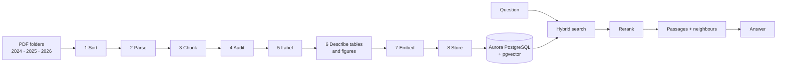

# How AskWRI turns WRI PDFs into cited answers

This page walks through the whole flow, from a folder of PDFs to the passages an answer cites.
Code: `askwri/ingest/` (ingestion) and `askwri/search.py` (search). Key terms are in **bold** and
listed in the glossary at the end.

Run it with `scripts/run-pipeline.sh 2024_publications 2025_publications 2026_publications`.

## Ingestion, step by step

1. **Sort.** Every PDF is fingerprinted. Exact duplicates, non-English files and older versions
   of the same report are dropped. Each kept file gets a document type (working paper, RFP,
   newsletter, technical note...). *Why:* the same report should never answer twice.

2. **Parse.** PyMuPDF's **layout model** reads each page in reading order and labels each region
   as body text, heading, table, picture, caption, or page header/footer. Headers and footers
   are kept out of the text but read for the **printed page numbers**, so a citation can say
   "p. 12" as printed, not the PDF's page 14.

3. **Chunk.** The text is cut into **chunks**: passages a reader can cite (see Chunking below).

4. **Audit.** Every chunk is checked word for word against the PDF's own text layer. A document
   whose words cannot be found is not indexed. A chunk whose words are right but re-ordered is
   kept but marked not **quotable**: it can be cited by page, never quoted.

5. **Label.** The document's **metadata** is gathered, WRI's own labels first:
   - From its **wri.org page**: title, date, authors, topic, tags, abstract, and the
     initiatives and programs it belongs to.
   - From the **labeler** model when there is no page: title, date, type, topic, countries.
   - From one **enrichment** call for every document: up to two topics, concepts, keywords,
     countries, regions, 3 to 5 key findings, genre and the years the data covers.
   - By rule: the **year** (publication date, else the folder's year) and the **acronyms** the
     text defines ("Offshore wind (OSW)").
   - A model never overwrites a label WRI supplied; its values come after WRI's.

6. **Describe tables and figures.** Numbers and pictures don't match words well, so a model
   writes a short **description** of each one for search (see Table search and Chart and map
   search below). Descriptions are never quoted as WRI's words.

7. **Embed.** Each chunk is turned into an **embedding**: 1,024 numbers that capture its
   meaning, so passages can be found by meaning rather than exact words. What is embedded is
   the chunk's **address** (document title › section), its description if any, and the text.
   Each document also gets a **document card** (title, abstract, labels, key findings) with
   its own embedding and keyword index.

8. **Store.** The PDF goes to S3 (the citation fallback). The document's rows in Aurora are
   deleted and re-inserted in one **transaction**, so search keeps working during a reload.
   Every model reply is saved in `.cache/ingest/` and replayed on the next run.

## Chunking strategy

- **Size band:** 400 to 2,000 characters (about 100 to 500 tokens). Shorter chunks embed as
  little more than their title; longer ones blur several ideas into one embedding.
- **Never cross a heading.** A chunk belongs to one section, and carries its **section path**
  ("Supply risks › Lithium").
- **Split long paragraphs at sentence ends**, into pieces of similar size. A single sentence is
  never cut.
- **Short neighbours join** within a section, and a short last piece is rebalanced with the
  one before it.
- **Tables are their own chunks**, split by rows when large (see below).
- **Stable IDs:** each chunk's ID (`<doc_id>#p<page>-<n>`) and its order (`seq`) stay the same
  across reruns, so citations don't break.
- **Roles:** chunks under References, Notes, Contents, Acknowledgements, About and Abbreviations
  get a **role**, and search skips them.
- *Tested:* bigger chunks (1,000 to 4,000 characters) scored no better on the evaluation set
  (docs/tasks/search-tuning.md).

## Table search

1. The layout model finds the table; ruled grids of names (not data) stay text.
2. The table becomes a **table chunk** in Markdown rows, with its number ("Table 2"), caption
   and notes. A large table is split by rows, repeating the caption and header row in each
   piece; later pieces point at the first.
3. The **labeler** writes a one- or two-sentence summary: the measure, units, places, period
   and the main pattern. The summary is embedded with the rows, and the reranker reads it.
4. So "Which table shows forest cover by country?" finds a table whose cells are only numbers.
   The answer quotes the rows, never the summary.

## Chart and map search

On main since 4 Nov (PR #45). **The corpus loaded on 4 Nov does not have it yet**: it was
loaded from a branch cut before that merge. A reload with the merged code adds it.

1. Pictures under 2% of the page (logos, icons) are skipped before any model call.
2. Each picture is paired with its caption or a nearby "Figure 3" / "Map 2" / "Box 1"
   label. A captioned picture is informative; an uncaptioned large one gets a cheap
   decorative-or-informative check from the labeler first. Scanned pages are not described.
3. The picture is rendered to a PNG, stored in S3 under `figures/`, and sent to the **vision**
   model with its caption and the text printed inside it (axis labels, legend).
4. The vision model writes a **description**: for a chart, the type, axes, units, takeaway and
   key values (marked approximate); for a map, the region, what is shown and the legend.
5. The picture becomes a **chart** or **image chunk**: the caption is its content, the
   description is embedded for search, and it is never quotable. An answer cites the figure
   by number and page.

## Models

| Role | Model (Amazon Bedrock) | Used for |
|---|---|---|
| `labeler` | Claude Haiku 5.5, effort low | fallback labels, enrichment, table summaries, picture triage |
| `vision` | Claude Sonnet 5.5 | chart and map descriptions |
| `embedder` | Cohere Embed v4, 1,024 dimensions, multilingual | chunk, card and question embeddings |
| `reranker` | Amazon Rerank 1.0 | final ordering and the relevance cutoff |
| `answerer` | Claude Sonnet 5.5 | writing answers; judging passages in the evaluation |

All are in `askwri/models.py`. Labeler calls use **structured output** (a JSON schema), so a
topic or region can only be a listed value.

## Search: hybrid, then rerank

`search_passages(question)` runs in one SQL statement, then one rerank call:

1. **Year filter.** "published in 2025" in the question becomes a filter on `year`.
2. **Vector search** (pgvector, **HNSW** index): the 100 chunks closest in meaning to the
   question's embedding.
3. **Keyword search** (PostgreSQL **full-text search**, `tsvector`): the 100 chunks that contain
   all the question's words, ranked.
4. **Reciprocal rank fusion (RRF):** the two lists are merged; a chunk high in both comes first.
5. **Per-document cap:** at most 6 chunks per document, so one report can't fill every slot.
6. **Rerank:** the top 25 go to Amazon Rerank, which reads each one's title, section and text
   and scores how well it answers the question.
7. **Relevance cutoff:** chunks scoring under 0.02 are dropped, and at most 10 are kept. If none
   is left, the answer **declines**: the corpus has no answer.
8. **Neighbours:** each kept chunk comes with the chunk before and after it in the same section,
   so the answering model reads it in context.

Search skips chunks with a role (references, contents...). How these settings were chosen, and
what was tried and dropped, is in docs/tasks/search-tuning.md.

## Glossary

- **Chunk:** one citable passage, the unit search returns.
- **Section path / address:** where a chunk sits: "Document title › Section › Subsection".
- **Quotable:** the chunk's words match the PDF exactly, so it can be quoted verbatim.
- **Role:** marks apparatus (references, contents, notes...) that search skips.
- **Metadata / labels:** facts about a document (year, topics, countries...) stored as columns.
- **Document card:** a document's title, abstract, labels and findings as one searchable text.
- **Embedding:** a list of numbers that captures meaning; close embeddings mean similar text.
- **Vector search:** finding chunks whose embeddings are closest to the question's.
- **HNSW:** the index that makes vector search fast over thousands of chunks.
- **Full-text search / tsvector:** PostgreSQL's keyword search.
- **Hybrid search:** vector and keyword search together.
- **RRF (reciprocal rank fusion):** merges ranked lists by position, not by raw score.
- **Rerank / relevance score:** a second model reorders candidates by how well each answers.
- **Decline:** returning no passages when nothing scores as relevant.
- **Structured output:** a model reply forced to match a JSON schema.
- **Transaction:** a group of database writes that all happen or none do.
